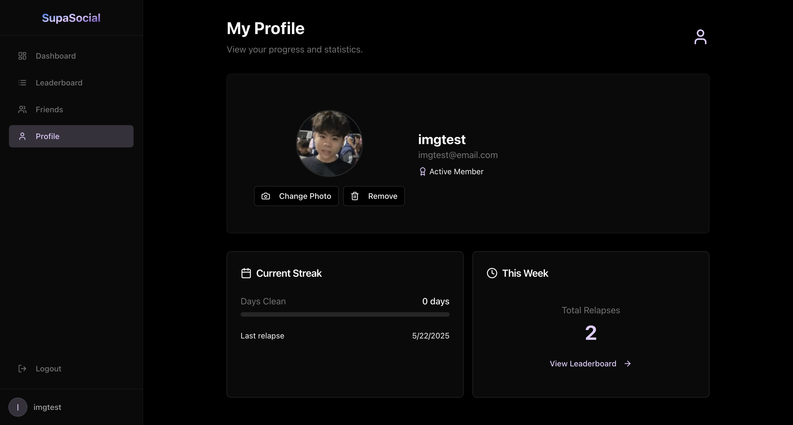
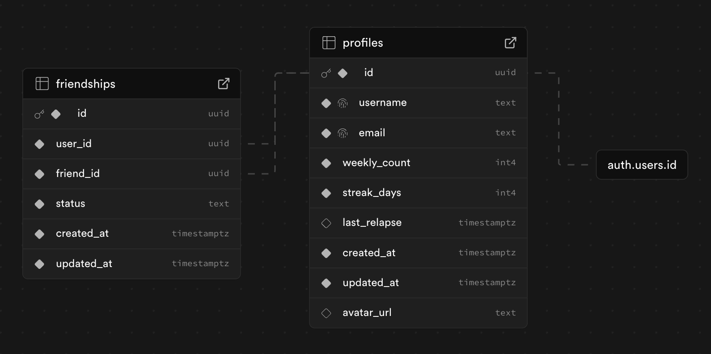

# SupaSocial: Supabase & React Social Media Starter

SupaSocial is a social media starter template built with React, Supabase, Zustand, and Tailwind CSS. 

> [!NOTE]
> Listed on [Awesome Supabase](https://github.com/lyqht/awesome-supabase?tab=readme-ov-file). The backing Supabase project is paused, but the template remains fully functional for new projects.



## Features

- **Authentication**: Sign up, sign in, and session management.
- **Profiles**: Customizable avatars and user tracking.
- **Friend System**: Send, accept, and manage friend requests.
- **Dashboard**: Personal activity tracking and streak counters.
- **Leaderboard**: Competitive rankings.
- **Real-time Updates**: Live data synchronization via Supabase Realtime.
- **UI**: Interface built with shadcn/ui and Tailwind CSS.
- **Type Safety**: TypeScript support with generated database types.
- **State Management**: Handled via Zustand.

## Database Structure



The application uses two primary tables and a storage bucket.

### Profiles Table
- `id` (UUID): Primary key, links to auth.users.
- `username` (TEXT): Unique identifier.
- `email` (TEXT): User email.
- `weekly_count` (INTEGER): Weekly activity counter.
- `streak_days` (INTEGER): Current streak tracking.
- `last_relapse` (TIMESTAMPTZ): Last activity reset timestamp.
- `avatar_url` (TEXT): Profile picture URL, links to storage bucket.
- `created_at` & `updated_at` (TIMESTAMPTZ).

### Friendships Table
- `id` (UUID): Primary key.
- `user_id` (UUID): Requester.
- `friend_id` (UUID): Recipient.
- `status` (TEXT): 'pending' or 'accepted'.
- `created_at` & `updated_at` (TIMESTAMPTZ).

### Storage Bucket
- `avatars`: Profile pictures.

## Getting Started

### Prerequisites

- Node.js 18+ or Bun
- Supabase account
- Git

### 1. Create Repository

#### Option A: Template (Recommended)
1. Click **Use this template** > **Create a new repository**.
2. Clone your repository:
```bash
git clone https://github.com/YOUR_USERNAME/YOUR_REPOSITORY_NAME.git
cd YOUR_REPOSITORY_NAME
```

### 2. Install Dependencies

```bash
bun install 
```

### 3. Configure Supabase

1. Create a project at [supabase.com](https://supabase.com).
2. Note your project URL and anon public key from Settings > API.

### 4. Setup Database

Follow the instructions in [SUPABASE.md](SUPABASE.md) to set up tables, policies, and triggers in your Supabase SQL editor.

### 5. Configure Environment

Update `src/integrations/supabase/client.ts`:

```typescript
const SUPABASE_URL = "YOUR_SUPABASE_PROJECT_URL";
const SUPABASE_PUBLISHABLE_KEY = "YOUR_SUPABASE_ANON_KEY";
```

### 6. Run Development Server

```bash
bun dev 
```

App runs at `http://localhost:5173`

## Security

The app implements Row Level Security (RLS) to enforce data privacy. Users access and edit only their profiles. Friend profiles remain restricted to accepted friends. Supabase Auth handles sessions and passwords.

## Deployment

Deploy on Vercel by connecting your repository.
For Netlify, set the build command to `npm run build` and publish directory to `dist`.

## License

Available under the [MIT License](LICENSE).
